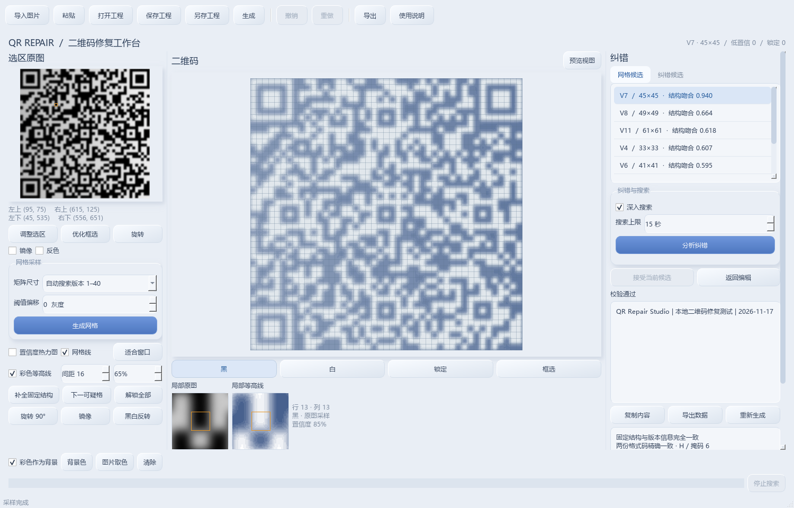

# QR Repair Studio

本地二维码修复桌面工具。支持模糊、透视、旋转图像的网格采样、手动编辑与纠错。



## 使用

从 [Releases](https://github.com/NaGeShuDai/QRRepairStudio/releases) 下载 Windows 压缩包，解压后运行 `QRRepairStudio.exe`。

导入图片 → 调整选区 → 生成网格 → 分析纠错 → 接受候选 → 导出。

- 自动定位三个定位码，摆正选区；支持镜像、反色和背景取色。
- 搜索版本 1–40，按黑白倾向生成网格，固定定位结构。
- 黑白绘制、框选填充、锁定、撤销与重做。
- 红色置信度热图、白至深蓝的填充等高线、局部原图对照。
- 黑白二维码预览，包含四格留白。
- Reed–Solomon 纠错，校验固定结构、格式、版本、数据段和填充位。
- 保存 `.qrr` 工程，导出 PNG、SVG、模块矩阵及解码数据。

滚轮缩放，中键平移。`Ctrl+O` 导入，`Ctrl+S` 保存，`Ctrl+Z` 撤销，`Ctrl+Y` 重做。

## 开发

Python 3.12，Windows：

```powershell
python -m venv .venv
.\.venv\Scripts\python.exe -m pip install -r requirements-dev.txt
.\.venv\Scripts\python.exe main.py
```

测试与打包：

```powershell
.\.venv\Scripts\python.exe -m pytest -q
.\.venv\Scripts\python.exe build.py
```

输出：`dist/QRRepairStudio/QRRepairStudio.exe`。`samples/` 包含原图、模糊透视图片和损坏工程。

采用 PySide6、OpenCV、ZXing-C++、python-qrcode、reedsolo、NumPy、Pillow。第三方许可证见 `THIRD_PARTY/`。
